# VTCode Waveform Viewer

A native terminal waveform explorer for VTCode. Open VCD or FST simulation dumps,
browse a design hierarchy, and inspect digital buses and analog values alongside
two time cursors. The viewer never modifies the source dump.

The interaction design takes inspiration from [VaporView](https://github.com/Lramseyer/vaporview),
AMD/Xilinx Vivado's waveform window, and Synopsys nWave: signal names and cursor
values beside a shared timeline, with transition navigation, measurement cursors,
groups, markers, and persistent view configuration. This is an independent Rust
implementation using VTCode's terminal extension API.

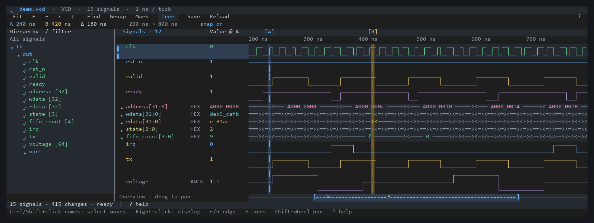

The workspace opens with signal names, **Value @ A**, and the waveform timeline.
**File / Signal / View / Waveform / Cursors / Tools** menus organize commands;
the hierarchy opens through **Signals** / `/` and closes with its `×` control.
A graduated full-recording ruler and time navigator keep the zoomed window in
context. The navigation toolbar exposes
Fit, Detail, Back, A–B fit, and exact edge stepping. **Back** / Shift+Z restores
previous zooms and selected ranges without moving either measurement cursor.
The default value pane fits a full 32-bit **before → after** pair; saved custom
column widths are preserved.
For an existing compact saved view, **View → Normal heights for all waves**
restores square digital edges and full bus envelopes in one undoable edit.

Enable **Inspect** / `v` for detailed measurements. In views of at least 80 × 30
cells, a docked **Inspector** displays the selected
or hovered signal's full path, values, recorded interval, and signed B−A time
difference. Inspection leaves the waveforms visible and clearly labels Pointer,
A, and B. **Inspect** / `v` toggles the dock and saves the preference. Short views
use the floating inspector to retain space for the waveform.

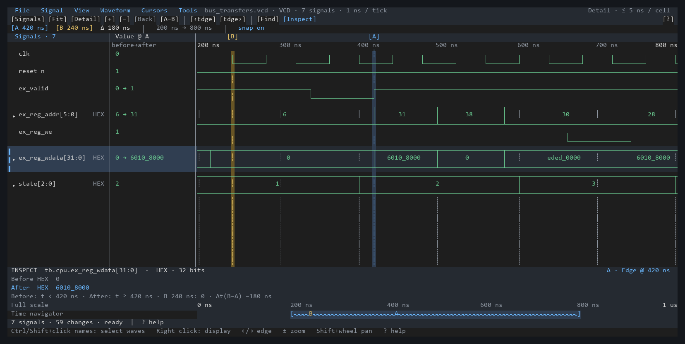

## Try it in VTCode

Use a VTCode build with GitHub release-package installation support.
Run **Extensions: Install Extension from GitHub** in the command palette,
paste `https://github.com/im-henri/vtcode-ext-waveform-viewer`, and select
`v0.2.1`. VTCode downloads the runtime ZIP attached to the release, not the Git repository.

To build from source, clone this repository and install into a VTCode workspace:

```powershell
python tools/build.py --install-local C:\path\to\workspace
```

Run **Extensions: Reload All Extensions** in VTCode's command palette. Open
`examples/demo.vcd` and select **Waveform Viewer** in the file-open chooser, or
use **Open With Waveform Viewer** from the explorer context menu. The command
**Open File as Waveform** uses the current file or explorer selection.

Drag a waveform tab to an editor's left, right, top, or bottom edge to create
a split. The highlighted half previews its placement. Waveform tabs support
creating the first split directly and moving between existing panes.

The first 12 distinct traces are added automatically; aliases remain available
in the browser. Press **Signals** or `/` and type a signal path in the inline
search. Up / Down chooses a result; one Enter adds it and returns to the waves.
Esc restores the previous filter. Tab moves between hierarchy and waves.
Drag a signal from **All signals** into the watched list or timeline to place it
anywhere. A highlighted waveform preview makes room at the proposed insertion
point. Releasing commits one undoable edit; existing watches move with their
formatting intact. Hold near an edge to scroll, or use the wheel while dragging.
A badge follows the pointer with the signal name and Add / Move action; invalid
drop areas show a red Cannot drop badge. Escape or releasing outside cancels.

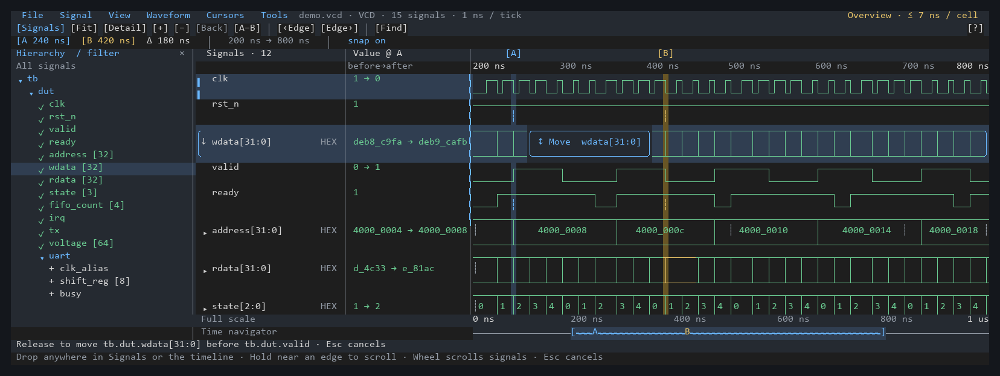

Right-click a signal's name, value, or waveform to choose **Hexadecimal**, **Binary**,
**Unsigned / Signed decimal**, **Octal**, **ASCII**, or **Analog plot** directly.
The same menu offers **Small / Normal** waveform sizes, digital display, bus
expansion, colors, find, rename, copy at A, and removal. Right-click a signal in
**All signals** to add it with the desired display. Checked items show the current settings; unsupported bit
or real-signal choices are dimmed. Arrow keys and Enter work in menus;
Shift+F10 opens the selected signal's menu, and Esc or clicking outside closes it.
Menus stay above the footer and show a scrollbar when needed. Drag its thumb,
scroll, or use Page Up / Down to reach more actions. Type a letter to select a
matching action; the displayed shortcuts (including 1–8 for color) work inside
the menu. Each bus shows its current HEX / DEC / SGN / BIN / OCT / TEXT format
beside its name; analog signals show ANLG.

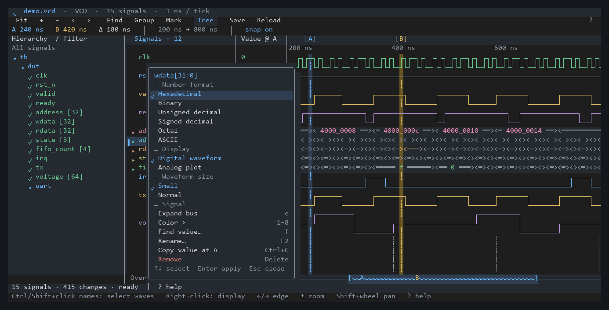

**Ctrl+click** watched names or values to toggle individual waves. **Shift+click**
selects a range, and **Ctrl+Shift+click** adds a range to the selection.
Shift+Up / Down extends the selection from the keyboard; Ctrl+A selects all
visible watched rows, including expanded bits. Esc returns to one selected wave.
Selected waves are highlighted together, with a count above the signal list.
Right-click any selected row to change the selection's number format, digital /
analog display, color, or size. A dash marks mixed settings; incompatible rows
are skipped. Delete removes the selected watched rows. Each bulk edit is one
undo step. Ctrl / Shift gestures over the timeline continue to pan / zoom.

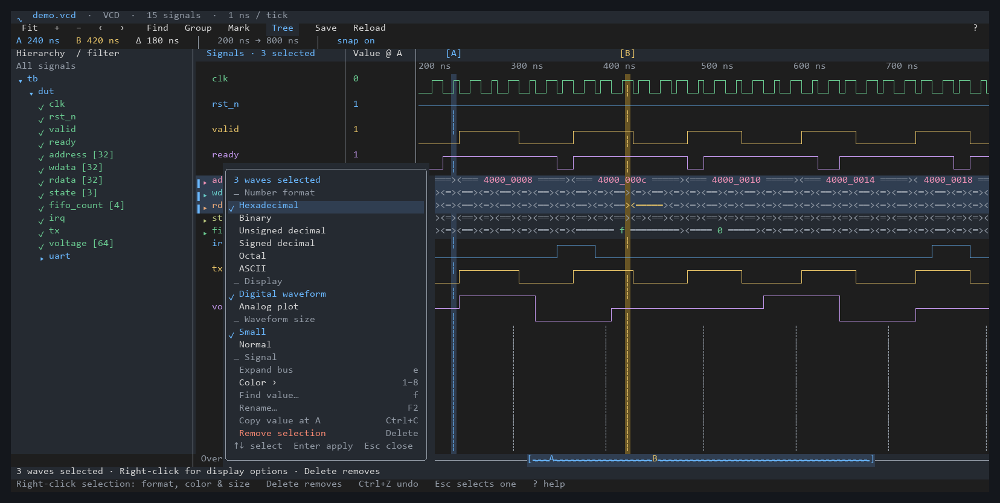

Drag either column divider to resize signal names or values. Right-click a
**Signals** or **Value** header to fit names, fit full values at cursor A, or
reset both widths. Resizing previews live; Esc restores the previous width,
and a completed resize is one undoable edit. Widths survive saving and reopening.
Scrollbars in the hierarchy and watched list are draggable; clicking their
tracks pages through signals without changing the selection.

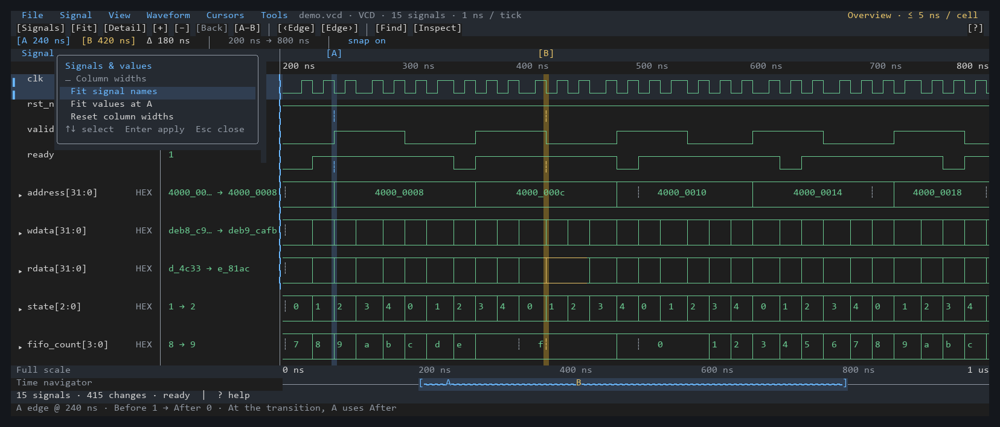

The **[A] / [B]** handles above the ruler drag either cursor directly. Nearby
handles stay separate so B remains accessible when both cursors share a time.
Esc restores the cursor's previous position. Clicking the **snap on / off**
readout toggles edge snapping; `s` remains available from the keyboard.
Click the **A / B time fields** to enter an exact time. Middle-click / drag sets
B; Alt+click / drag is also available. `x` exchanges A and B. Middle-button input
and double-click recognition require the updated VTCode host API in this workspace.

**Mark**, **Group**, **Rename**, **Find**, **Go to time**, and session
import open centered dialogs with a focused text field, visible action and
Cancel buttons, a close control, and inline validation. Enter applies; Esc,
Cancel, or clicking outside discards the query. Tab moves between the field
and buttons. Left / Right, Home / End, Delete, Backspace, and Ctrl+A support
editing names without starting over. Canceling a live filter restores it.

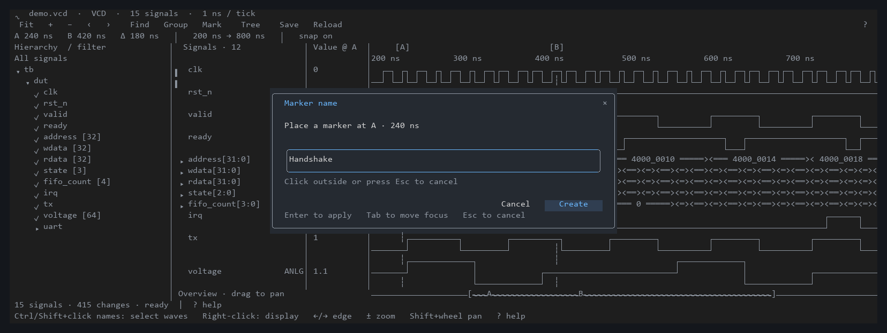

Press `?` for the built-in controls. F5 reads a newly generated simulation while
retaining matching watched signals, radix, colors, cursors, markers, and zoom.
Help scrolls with the wheel, arrows, or Page Up / Down; its content wraps in
narrow windows. Home / End jump through the reference, and Esc closes it.

Each waveform has its own **Small / Normal** size, set from its right-click
menu. Press `h` to change the selected waveform or selection. Sizes survive moving,
undo/redo, saving, and reloading; expanded bus bits can be sized independently.
Single-bit signals start at Normal with square transitions across two terminal
rows. Buses start at Normal with three-row envelopes, straight transfer boundaries,
and complete values. Small sizes are available explicitly; small single-bit
traces use vertical edges. Analog plots use two rows at
Small and three at Normal. Explicit per-wave sizes survive reopening. Older
saved views with a global density setting use Normal for single-bit signals and
expanded bus bits, while retaining the previous bus sizes.
Hex values use readable four-digit groups (`6010_8000`); leading zeros are
suppressed. A value is drawn only when the whole label fits with space around
it. Zoom in to resolve short transfers. Hover anywhere on a trace to inspect
the exact time, value, and recorded interval, including values omitted from the
trace. **Value @ A** always shows the exact value at cursor A, including while
hovering. The separate **Pointer @ time** inspector shows the hovered value;
Ctrl+C copies it. Hovering the Value column inspects and copies the value at A.
At a transition, the value column shows **before → after**, keeping both sides
visible even when the pair needs ellipses. Hover the value or the waveform edge
to see separate, fully labeled **Before** and **After** values and the exact edge
time. Before applies strictly before that time; After applies at the timestamp
and until the next change. Ctrl+C copies After. Auto-fit Values reserves room
for the complete pair. Expanded bits only report their own changes.

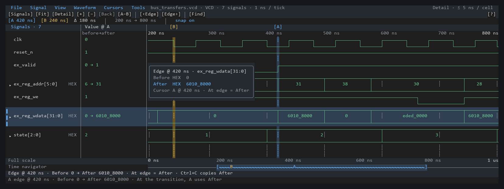

Zooming out pauses at a terminal detail limit: two columns for logic levels and
enough room for formatted bus values. Press `-` again to continue; **Fit** / `0`
always shows the entire recording. Compressed cells become an explicit
**Overview**, with `▒` shading wherever multiple changes share a cell. Pulses
that return to the same value remain visible, including in expanded bus bits
and analog plots. Shading represents activity, never a logic level or bus value.
The timeline header reports the time covered by one terminal cell.

Choose **Detail** (or `i`) to inspect the selected signal around A. To investigate
a compressed cell anywhere else, hover it and press `i`: the cell's time interval
fills the timeline, preserving both cursors. Repeat to drill down further.
Double-clicking a compressed cell performs the same drill-down. Detail also
reserves space for bus labels; narrow intervals are identified as an overview.
Left / Right still move to exact transitions even when several share a cell.
Edge snapping skips compressed cells instead of choosing an arbitrary hidden edge.

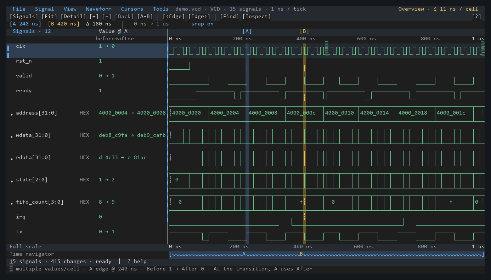

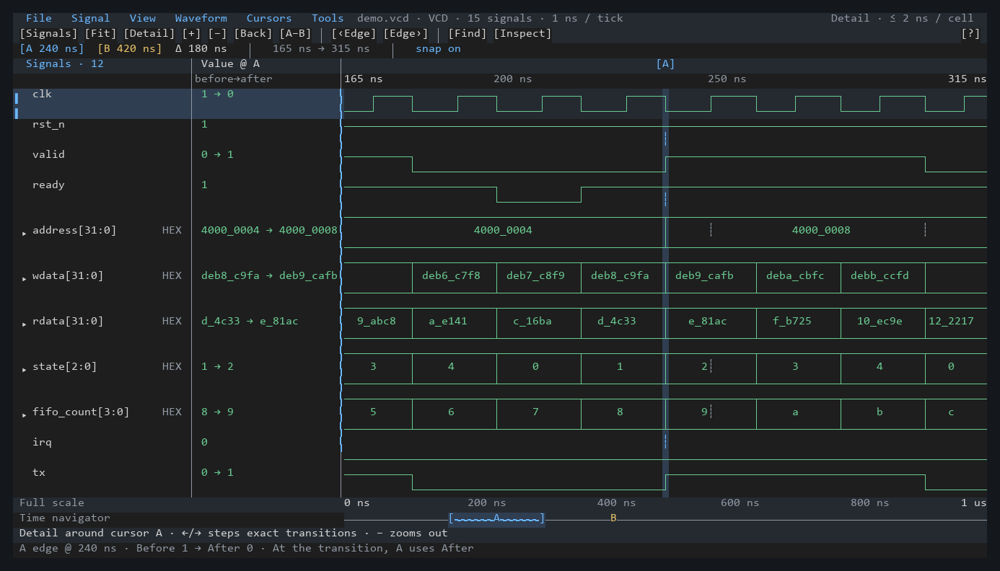

For extremely dense parent buses, resolving an individual bit is bounded to keep
interaction responsive. A `░` cell explicitly means **unresolved**, rather than
claiming that bit stayed constant; zoom in to resolve it. A `·` trace means no
value has been recorded yet, distinct from a simulator's `x` or `z`.

Hover a signal name to see its full hierarchy path, width, type, and format.
Hover the Value column to inspect and copy that row's exact value at A without
selecting it. A subtle row highlight follows inspection; colored A/B guides
cross traces while preserving every value character. The hierarchy and watched
list show scroll indicators when they overflow. Click `×` beside a filter to
clear it, including when there are no matching signals.

Shift+drag on a trace or the ruler previews a shaded time range and its duration;
release to zoom or press Esc to cancel. Click the ruler to place A, or Alt+click
to place B. The overview shows the viewport, cursors, and markers. Drag inside
its viewport to pan without a jump; clicking outside centers the window there.
Escape during an overview drag restores the previous time window.

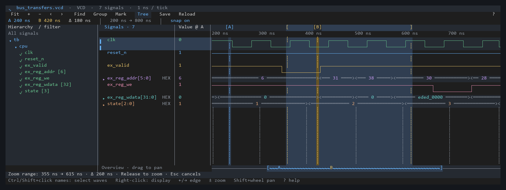

`examples/bus_transfers.vcd` is a small register-transfer example matching this
style. `examples/demo.vcd` also demonstrates dense transitions, X/Z states,
aliases, and analog traces.

For a standalone native preview, without installing the extension:

```powershell
cargo run --locked --example preview -- examples/demo.vcd
```

Press `q` to quit the preview. It uses the same parser, rendering, and input
model as the Wasm extension. Ctrl+S in the preview writes
`waveform-session.json`; clipboard operations are provided by VTCode only.

## Features

- Incremental VCD loading with cancellation and progress. Pure Rust FST decoding,
  including gzip-wrapped FST, with no simulator installation or native DLL.
- Hierarchy browsing, path filtering, scope addition, signal aliases, and bus
  slices. Stable signal paths preserve separately dumped bits and slices.
- Four-state digital traces with visible X/Z states; collapsed bus values;
  expandable bus bits; analog plots for real or numeric signals. Dense transitions
  are indicated at the current terminal resolution.
- Straight bus rails with centered, complete labels and vertical transfer
  boundaries. Hover inspection, wrapped wide values, and readable measurement guides
  preserve the data beneath the pointer and cursors.
- Binary, hexadecimal, octal, unsigned, signed, and ASCII value display. Integer
  timestamps and zoom calculations preserve precision beyond floating-point time.
- Cursors A/B, delta measurement, named markers, edge snapping, previous/next
  transition, rising/falling edges, goto time, and cancellable value searches.
- Eight signal colors, renamed signals, collapsible groups, dividers, drag or
  keyboard reordering, undo/redo for signal-list edits, and adjustable name width.
- Mouse-centered zoom, live range-zoom previews, ruler cursors, panning, signal
  scrolling, and a draggable time overview with viewport and cursor positions.
- Full-path hover details, value-column inspection, overflow indicators,
  clearable hierarchy filtering, and a scrollable responsive controls reference.
- Per-file sessions, clipboard values, and JSON session export/import.

## Controls

| Task | Keyboard / mouse |
| --- | --- |
| Select signal / hierarchy item | Up / Down, Page Up / Down |
| Switch hierarchy and waves | Tab |
| Signal display options and actions | Right-click a signal or Shift+F10; arrows select, Enter applies, Esc closes |
| Select multiple watched waves | Ctrl+click names / values; Shift+click or Shift+Up / Down selects a range; Ctrl+Shift adds a range |
| Select all / return to one wave | Ctrl+A / Esc in the watched list |
| Query dialogs | Enter applies; Tab moves focus; Esc, Cancel or clicking outside dismisses |
| Filter signal paths | `/` or Ctrl+F; Enter finishes the filter |
| Add a signal / expand a scope | Enter or Space in the hierarchy |
| Place a signal at any position | Drag from All signals into Signals or the timeline; release on the live waveform preview |
| Move an already watched signal | Drag it from All signals or by its watched name; its formatting and bus expansion are preserved |
| Scroll while placing a signal | Hold near the top / bottom edge or use the wheel; Esc or releasing outside the drop area cancels |
| Add all descendants of a scope | Shift+Enter, up to the watch limit |
| Toggle hierarchy / full paths | `b` / backtick |
| Small / Normal size of one waveform | Right-click signal → Waveform size, or `h` |
| Previous / next transition | Left / Right, or Shift+N / `n` |
| Next rising / falling transition | `u` / `j`; Shift reverses direction |
| Move cursor B to an edge | Alt+N / Alt+Shift+N, or Alt+click an edge button; VTCode reserves Alt+Left / Right for workbench navigation |
| Zoom / fit duration | `+` / `-`, `0` or Ctrl+0 |
| Resolve a readable view around A | **Detail** or `i`; zoom-out pauses at the terminal detail limit, then `-` continues |
| Return to previous zoom / range | **Back** or Shift+Z |
| Fit the A–B measurement | **A–B** or `z` |
| Show / hide the docked inspector | **Inspect** or `v`; docks when the view is at least 80 × 30 |
| Inspect a compressed cell | Hover it and press `i`; repeat to drill down, with A/B preserved |
| Pan | Shift+wheel (up = left, down = right), horizontal wheel, wheel over traces, Shift+Left / Right, or Ctrl+drag |
| Zoom at pointer / preview range zoom | Ctrl+wheel / Shift+drag on traces or the ruler; release applies, Esc cancels |
| Navigate with the overview | Drag its highlighted viewport; click outside to center; Esc during a drag restores the previous window |
| Goto time / beginning / end | Ctrl+G (ticks or `125 ns`), Home / End |
| Cursor A / B | Click or drag a trace or the ruler / Alt+click or drag |
| Inspect time and value without moving cursors | Hover over a trace; Ctrl+C copies the value |
| Adjust A / B directly | Drag its [A] / [B] handle above the ruler; Esc restores its time |
| Resize / fit signal columns | Drag either divider; right-click Signals / Value headers for auto-fit or reset |
| Scroll long signal lists | Drag the hierarchy / Signals scrollbar thumb; click its track to page |
| Inspect a clipped name / value at A | Hover the watched name / Value column; Ctrl+C copies the hovered row's value |
| Set / remove B at A | Shift+B |
| Zoom between A and B | `z` |
| Toggle edge snapping | `s` |
| Add marker / remove marker at A | `m` / Shift+M |
| Previous / next marker | `[` / `]` |
| Cycle radix / analog plot / bus expansion | `r` / `a` / `e` or Enter |
| Signal color / rename | `1`–`8` / F2 |
| Group / divider / remove row | `g` / `d` / Delete |
| Reorder watched rows | Alt+Up / Down or drag the signal name |
| Scroll watched signals | Wheel over labels |
| Resize names | Drag the boundary between name and value columns |
| Find a value / repeat | `f` or Ctrl+H / F3; Shift+F3 searches backward |
| Save / undo / redo signal edits | Ctrl+S / Ctrl+Z / Ctrl+Y |
| Copy value / export session JSON | Ctrl+C / Ctrl+E (also Ctrl+Shift+C) |
| Import session JSON | Ctrl+V, then Enter |
| Reload source / cancel load or search | F5 / Escape |
| Help | `?`; wheel, arrows, Page Up / Down, Home / End scroll; Esc closes |

Value search uses the selected row's radix. Prefixes `0x`, `0b`, and `0o` override
it; `x` and `z` find unknown/high-impedance states. Search wraps once and runs in
bounded background steps. Expanded-bit searches ignore changes to other bits.

Ctrl+S saves view settings to VTCode's extension settings, keyed by the complete
file path. Closing the last copy of a view also saves it and releases parsed
data. Use Ctrl+S before exiting VTCode to persist changes without closing the
tab. Saved views restore when reopening the same path; unavailable signals are
skipped. Ctrl+E copies portable session JSON, which can be saved as a text file
and imported into another compatible dump with Ctrl+V. Source bytes are read-only.

## Build and verify

Rust 1.98.0 and `wasm32-unknown-unknown` are selected by `rust-toolchain.toml`.
The extension is self-contained: its SDK is vendored, and Cargo.lock pins
dependencies. No files outside this directory are needed to build it.

```powershell
python tools/build.py
cargo clippy --locked --all-targets -- -D warnings
```

The build script checks formatting, runs native tests, builds release Wasm, and
copies it to `waveform-viewer.wasm`. Add `--offline` after fetching dependencies.
`--install-local PATH` copies a runnable package into the specified workspace's
`.vtcode/extensions/waveform-viewer`. It leaves this source directory in place.
`--host-fixtures PATH` refreshes the main VTCode repository's integration fixtures.

Native tests exercise chunk boundaries, malformed dumps, exact time arithmetic,
navigation, search cancellation, input, sessions, responsive layout, bus geometry,
label fit, dense transfers, and passive hover. VTCode
also contains tests that run the compiled Wasm through its actual document API,
worker queue, key/scroll/hover/context-menu routing, dialogs, drag badges, and
ratatui renderer. Invalid queries and canceled dialogs preserve session and undo state.

Measure loading separately from preview rendering with:

```powershell
cargo run --locked --release --example bench_loading -- target/loading.json
```

This benchmark generates a dense 32-bit bus dump and a metadata-heavy file,
then reports median parser/streaming time, allocations, and source read calls.
In a checkout of the VTCode repository, `cargo test --bin vtcode
waveform_wasm_loading_benchmark -- --ignored --nocapture --test-threads=1`
measures actual Wasm, file I/O, the idle scheduler, and workbench drawing.
See [loading measurements](docs/loading-performance.md) for before/after results
and the measurement conditions.

Rendering and stacked-pane resizing have separate benchmarks. See
[resize measurements](docs/resize-performance.md) for results, reproduction
commands, and the host and guest changes that keep both panes updating.

Generate reproducible preview artifacts with:

```powershell
New-Item -ItemType Directory -Force screenshots
cargo run --locked --example preview -- --html > screenshots/demo.html
cargo run --locked --example preview -- --json > screenshots/frame.json
python examples/render_preview.py screenshots/frame.json screenshots/demo.png
```

`python tools/render_previews.py --offline` regenerates all documentation PNGs
from the native viewer, including hover, waveform sizes, drag, range, and Help examples.

The optional PNG renderer requires Pillow and a monospace font (Consolas by
default; use `--font PATH` on other platforms). `--text` prints a plain frame;
`WAVE_WIDTH` and `WAVE_HEIGHT` select preview dimensions.
`WAVE_START` and `WAVE_SPAN` set the time window in source ticks;
`WAVE_HOVER_X` and `WAVE_HOVER_Y` add a reproducible pointer inspection.
`WAVE_SIZE=small` or `normal` sets every preview signal to that size; without it,
the preview uses Normal sizes for both single-bit signals and buses.
`WAVE_DRAG_SIGNAL`, with optional `WAVE_DRAG_X` / `WAVE_DRAG_Y`, previews a drop.
`WAVE_RANGE_START` / `WAVE_RANGE_END` preview a time range in source ticks.
`WAVE_HELP=1`, with optional `WAVE_HELP_SCROLL`, renders the controls reference.
`WAVE_MENU_SIGNAL=wdata` renders a signal context menu. `WAVE_QUERY=marker`,
with optional `WAVE_QUERY_TEXT` / `WAVE_QUERY_SUBMIT`, renders a query or validation state.

## Current bounds

The viewer deliberately bounds work and memory inside VTCode's 128 MiB Wasm
runtime. VCD uses a reusable 128 KiB read-ahead buffer, parsed in 16 KiB steps.
Background turns adapt to a 6 ms work slice, with a 1 MiB ceiling and a fuel
reserve before yielding to input. Complete tokens are parsed directly from the
read buffer; split tokens and pending bus values reuse their storage.
Files can be larger than the data budget when
comments or repeated values dominate. Limits are 40,000 declared signals,
16,384 bits per signal, 48 MiB of accounted waveform data per dump, and 56 MiB
across open waveforms. Close unneeded waveforms to release their data.

FST input and its gzip-unwrapped form are limited to 8 MiB, with 16 MiB decoded
blocks. Larger FST dumps should be converted to VCD or reduced at the simulator.
FST value decoding runs as one bounded worker call after reading the file;
Escape cancels between loading steps. Very complex compressed FST files may
exceed the worker budget; they are not a large-file, disk-indexed database.

There are at most 256 watched signals/groups/dividers, 32 markers, and 64 undo
states. Bus expansion shows up to 64 least-significant bits; the collapsed
value still represents the whole bus. Decimal/analog conversion supports up to
128 bits; wider values retain hexadecimal/binary display. The drawing surface
is capped at 512 columns × 200 rows and clips to smaller terminals.

FSDB, WDB, GHW, RTL source navigation, live simulator control, and protocol
decoders are not implemented. Convert proprietary waveform databases to VCD/FST
with your simulator's tools. The viewer supports completed dumps; use F5 after
a simulator finishes writing a new version.

## VTCode host support

This extension uses VTCode API v2 plus these additive capabilities implemented
alongside it in [VTCode 0.1.5](https://github.com/im-henri/vtcode/tree/v0.1.5):

- `chart1`–`chart8` color roles with readable theme contrast.
- Scroll axis and full Control/Shift/Alt modifiers; the existing `ctrl` field
  remains available for older extensions.
- File-specific open commands also appear for binary files such as FST,
  alongside generic binary viewers.
- Background task callbacks with a separate 250-million-fuel budget, retaining
  10-million-fuel UI callbacks. Frame generation is scheduled separately from
  input callbacks, which keeps large terminals usable.
- `editor::read_document_into` for reusable guest read buffers, with direct
  host-to-guest reads and fewer sequential file seeks. `editor::task_should_yield`
  lets the loader adapt to elapsed work and remaining fuel between parse steps.
- Ordered input processing in a bounded background queue; registered work
  continues through tab closure until cleanup unregisters it. Cosmetic ticks
  still require an open view.
- Fair scheduling between input and background work, deduplicated viewport
  resize requests, and redraws when a worker actually publishes a visual
  change. Loading progresses while idle without repeated resize callbacks
  starving the loader. Published frames are shared between the host's view,
  tab, and drawing paths to avoid copying the whole surface on every event.
- Coalesced workbench splitter drags and direct structured-surface painting,
  with cached readable styles and fast ASCII/plot glyph handling. The viewer
  reuses rendering storage and updates dirty panes fairly during resizing.
- `editor::action::RELOAD`, which reopens clean documents and refuses unsaved
  edits, active transactions, and unsaved text-editor conflicts.
- An opt-in `editor::register_close_handler` and `closed` event after a view's final tab closes across groups,
  for releasing parsed data and saving guest settings.
- An opt-in `editor::register_hover_handler` with `move` / `leave` events,
  relative coordinates, and modifiers. Consecutive moves are coalesced while
  clicks, drags, and keys retain their order. Existing mouse handlers keep their
  down/drag/up behavior.
- Opt-in `editor::enable_pointer_capture`, retaining drag and release events
  outside the view with `pointerInside`, plus cancellation on interrupted
  gestures. This keeps waveform placement separate from workbench selection.
  Consecutive drag motions coalesce to their latest position without crossing
  press, release, key, wheel, or modifier boundaries.
- Opt-in `editor::register_context_menu_handler`, delivering right-click
  coordinates and modifiers to rich views. Other views retain their normal
  right-click behavior.

The contract is documented in the
[VTCode extension API guide](https://github.com/im-henri/vtcode/blob/v0.1.5/extension-api/README.md)
and the [vendored SDK guide](vendor/vtcode-extension-api/README.md). Use VTCode
0.1.5 or newer; earlier API v2 hosts do not provide every capability used here.

## License

MIT. See [LICENSE](LICENSE), [THIRD_PARTY_NOTICES.md](THIRD_PARTY_NOTICES.md), and
the vendored dependency license files. The included VCD examples are generated
by `examples/generate_demo.py` and `examples/generate_transfer_demo.py`; the small
GCD FST fixture is attributed separately.

## Publish a VTCode release

Keep `extension.json`, `Cargo.toml`, and `Cargo.lock` versions identical. Build
and test the extension, then run:

```sh
python package.py --tag v0.2.1 --output dist/vtcode-extension.zip
```

`package-files.json` explicitly lists the manifest, prebuilt Wasm, documentation,
and license notices needed in the runtime package. Source trees, Git metadata,
build scripts, and unlisted files are excluded. Add runtime assets to this list
when needed. ZIP creation is reproducible and streams files in bounded chunks.

Create and push the matching version tag. The Release workflow builds and tests
the extension and attaches `vtcode-extension.zip` to its GitHub release. A tag
without this package is not installable in VTCode. Existing published packages
are never overwritten: publish a new version for corrections.

Private GitHub releases use your existing `gh auth login` sign-in, or
`GH_TOKEN` / `GITHUB_TOKEN`. VTCode retrieves release metadata and the runtime
ZIP directly; it never clones the repository to install an extension.
